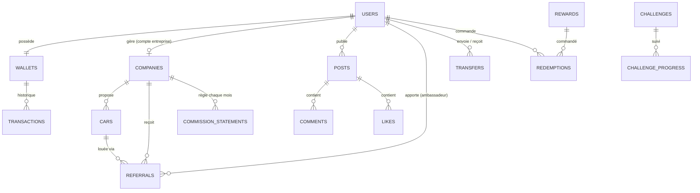

# Conception de la base de données — Dada Commission

Base : **Cloud Firestore** (Firebase), projet `dada-commission`.
Fichiers (photos, documents d'entreprise) : **Firebase Storage**.
Logique sensible (coins, transferts, validations) : **Cloud Functions**.

> Règle d'or : l'application **lit** librement ce qui la concerne, mais elle
> n'**écrit jamais** directement un solde de coins. Tout mouvement d'argent
> virtuel passe par une Cloud Function qui écrit le solde **et** une ligne
> d'historique dans la même transaction.

---

## 1. Vue d'ensemble



| Collection | Modèle Dart | Qui écrit ? | Rôle |
|---|---|---|---|
| `users/{uid}` | `AppUser` | l'utilisateur (champs de profil) + Functions | Profil, type de compte, code, niveau |
| `referralCodes/{code}` | — | Functions | Réserve un code unique → `{uid}` |
| `companies/{id}` | `RentalCompany` | gérant (dossier) + équipe Dada (statut) | Agences de location du hub |
| `companies/{id}/statements/{yyyy-mm}` | — | Functions | Relevé mensuel des commissions dues |
| `cars/{id}` | `Car` | gérant de l'agence | Voitures à partager |
| `posts/{id}` | `Post` | auteur | Fil d'actualité |
| `posts/{id}/comments/{id}` | `Comment` | utilisateur connecté | Commentaires |
| `posts/{id}/likes/{uid}` | — | l'utilisateur | J'aime (1 doc par personne) |
| `referrals/{id}` | `Referral` | Functions uniquement | Une location apportée par un code / lien / QR |
| `wallets/{uid}` | `Wallet` | Functions uniquement | Solde de Dada Coins |
| `wallets/{uid}/transactions/{id}` | `CoinTransaction` | Functions uniquement | Historique (jamais modifié) |
| `transfers/{id}` | `CoinTransfer` | Functions uniquement | Envoi de coins entre comptes |
| `rewards/{id}` | `Reward` | équipe Dada | Boutique |
| `redemptions/{id}` | `Redemption` | Functions + équipe Dada | Commandes de cadeaux |
| `challenges/{id}` | `Challenge` | équipe Dada | Défis du mois |
| `users/{uid}/challengeProgress/{id}` | — | Functions | Avancement d'un défi |
| `users/{uid}/stats/{période}` | `ReferralStats` | Functions | Clics, réservations, terminées |

---

## 2. Les documents en détail

### `users/{uid}` — profil
| Champ | Type | Exemple / remarque |
|---|---|---|
| `displayName` | string | « Yasmine B. » |
| `photoUrl` | string? | URL Storage `users/{uid}/avatar.jpg` |
| `bio`, `city`, `phone`, `email` | string? | |
| `authProvider` | `google` \| `facebook` \| `whatsapp` | |
| `role` | `ambassador` \| `partner` \| `companyAdmin` \| `staff` | type de compte choisi à l'inscription |
| `setupComplete` | bool | `false` tant que l'assistant d'inscription n'est pas fini |
| `referralCode` | string | `YASMINE20` (majuscules, unique) |
| `tier` | `bronze` \| `silver` \| `gold` \| `diamond` | recalculé le 1er du mois |
| `completedRentals3m` | int | locations terminées sur 3 mois |
| `companyId` | string? | si compte entreprise |
| `venueName` | string? | si partenaire (hôtel, agence…) |
| `birthDate` | timestamp? | contrôle « 18 ans et + » |
| `isIdVerified` | bool | CIN vérifiée (cadeaux > 5 000 DC) |
| `isBanned` | bool | |
| `createdAt` | timestamp | |

### `companies/{id}` — entreprise de location
| Champ | Type | Remarque |
|---|---|---|
| `name`, `city`, `address`, `phone`, `email` | string | |
| `ownerUid` | string | gérant (`users/{uid}`) |
| `contactName` | string? | |
| `taxRegistrationNumber` | string | matricule fiscal |
| `rneNumber` | string? | identifiant RNE |
| `fleetSize` | int | |
| `isFlagship` | bool | `true` pour Dada Rent Car |
| `customerDiscountRate` | number | 0,05 (−5 % client) |
| `documents` | liste `{type, status, url, submittedAt}` | types : `rne`, `taxCertificate`, `managerId`, `insurance`, `rentalLicense` |
| `agreementAcceptedAt` | timestamp? | accord de commission accepté |
| `status` | `draft` → `pending` → `approved` (ou `rejected`, `suspended`) | seule l'équipe Dada passe à `approved` |
| `rejectionReason` | string? | |
| `createdAt` | timestamp | |

### `cars/{id}`
`companyId`, `companyName` (copie), `model`, `category`
(`citadine`, `compacte`, `berline`, `suv`, `utilitaire`, `luxe`), `pricePerDay`
(DT), `imageUrl`, `seats`, `transmission`, `city`, `isAvailable`.
Visible dans la marketplace seulement si l'entreprise est `approved`.

### `posts/{id}` (+ `comments`, `likes`)
`authorId`, `authorName`, `authorRole`, `authorTier`, `type`
(`status`, `carPromo`, `announcement`, `challenge`), `text`, `mediaUrls`,
copie de la voiture (`carId`, `carModel`, `carPricePerDay`, `carCompanyName`),
`referralCode`, `isSponsored`, compteurs `likeCount`, `commentCount`,
`shareCount` (tenus à jour par Functions), `createdAt`.

### `referrals/{id}` — une location apportée
| Champ | Remarque |
|---|---|
| `ambassadorId`, `referralCode` | qui a apporté le client |
| `companyId`, `carId`, `carModel` | |
| `customerMaskedName` | « S\*\*\*i » — le vrai nom n'est jamais stocké ici |
| `source` | `code` \| `link` \| `qr` |
| `rentalDays`, `pricePerDay`, `discountRate` | |
| `commissionRate` | taux de l'ambassadeur **figé** à la réservation |
| `isRepeatCustomer` | client qui revient dans l'année → moitié du taux, pas de remise |
| `status` | `booked` → `inProgress` → `returned` (7 jours d'attente) → `validated` ; ou `cancelled` / `refunded` |
| `bookedAt`, `startDate`, `returnedAt` | |

Calcul (classe `CommissionCalculator`, en millimes pour éviter les arrondis) :
`3 × 150 DT = 450 DT` → `−5 % = 427,500 DT` → `Or 16 % = 68,400 DT` → **684 DC**.

### `wallets/{uid}` et `wallets/{uid}/transactions/{id}`
Wallet : `balance` (coins disponibles), `pendingBalance` (coins en attente),
`lifetimeEarned`, `updatedAt`. Montants **entiers** (10 DC = 1 DT).

Transaction : `amount` (+ crédit / − débit), `type` (`commission`,
`challengeBonus`, `redemption`, `transferIn`, `transferOut`, `reversal`,
`expiry`, `adjustment`), `status`, `title`, `subtitle`, liens (`referralId`,
`transferId`, `redemptionId`), `counterpartyId/Name`, `createdAt`,
`expiresAt` (12 mois après le gain).

### `transfers/{id}`
`fromUserId`, `fromName`, `toUserId`, `toName`, `toReferralCode`, `amount`,
`note`, `status` (`pending`, `completed`, `failed`, `reversed`), `createdAt`.
Contrôles : pas vers soi-même, minimum 10 DC, solde suffisant.

### `rewards/{id}` et `redemptions/{id}`
Reward : `title`, `description`, `category`, `priceCoins`, `imageUrl`, `stock`,
`isActive`. Redemption : `userId`, `rewardId`, `rewardTitle`, `coins`, `status`
(`reserved` → `preparing` → `ready` → `delivered`, ou `cancelled`),
`pickupCode`, `createdAt`.

---

## 3. Les Cloud Functions

| Fonction | Déclencheur | Ce qu'elle fait |
|---|---|---|
| `onUserCreated` | Auth (1re connexion) | crée `users/{uid}` (`setupComplete: false`), `wallets/{uid}` à 0, réserve un `referralCodes/{code}` |
| `completeSetup` | appel depuis l'app | valide l'âge (≥ 18 ans pour un ambassadeur), enregistre le type de compte |
| `registerCompany` | appel | crée `companies/{id}` en `draft`, passe à `pending` quand les 5 documents + l'accord sont là |
| `reviewCompany` | console Dada | `approved` / `rejected` + notification |
| `trackClick` | lien `/r/{CODE}` | compte un clic dans `users/{uid}/stats` |
| `onBookingCreated` | système de réservation | crée `referrals/{id}` (anti auto-parrainage : même téléphone / CIN / carte) |
| `onCarReturned` | statut `returned` | ajoute les coins en `pendingBalance` |
| `releasePendingCoins` | tous les jours | après 7 jours sans litige : `pending` → `balance`, ligne `commission` |
| `onRefund` | statut `refunded` | reprend les coins (ligne `reversal`) |
| `transferCoins` | appel | débite / crédite les deux wallets + 2 lignes + `transfers/{id}`, en une transaction |
| `redeemReward` | appel | réserve les coins, crée `redemptions/{id}`, vérifie la CIN au-delà de 5 000 DC |
| `monthlyTierAndStatements` | le 1er du mois | recalcule les niveaux, crée le relevé de commissions de chaque entreprise |
| `expireCoins` | tous les jours | expire les coins de plus de 12 mois (alertes à J-30 et J-7) |
| `syncPostCounters` | likes / comments | met à jour `likeCount`, `commentCount` |

---

## 4. Règles de sécurité (brouillon)

```
rules_version = '2';
service cloud.firestore {
  match /databases/{db}/documents {
    function signedIn() { return request.auth != null; }
    function isMe(uid) { return signedIn() && request.auth.uid == uid; }
    function isStaff() { return signedIn() && request.auth.token.staff == true; }

    match /users/{uid} {
      allow read: if signedIn();
      // le profil est modifiable, sauf les champs « système »
      allow update: if isMe(uid) && !request.resource.data.diff(resource.data)
        .affectedKeys().hasAny(['role','tier','referralCode','completedRentals3m',
                                'isIdVerified','isBanned','companyId']);
      allow create, delete: if false; // via Functions
    }
    match /wallets/{uid} {
      allow read: if isMe(uid);
      allow write: if false;
      match /transactions/{id} { allow read: if isMe(uid); allow write: if false; }
    }
    match /companies/{id} {
      allow read: if signedIn();
      allow update: if signedIn() && resource.data.ownerUid == request.auth.uid
        && request.resource.data.status == resource.data.status; // pas d'auto-validation
      allow create, delete: if false;
    }
    match /cars/{id} {
      allow read: if signedIn();
      allow write: if signedIn() && get(/databases/$(db)/documents/companies/$(request.resource.data.companyId)).data.ownerUid == request.auth.uid;
    }
    match /posts/{id} {
      allow read: if signedIn();
      allow create: if signedIn() && request.resource.data.authorId == request.auth.uid;
      allow update, delete: if signedIn() && resource.data.authorId == request.auth.uid;
      match /comments/{c} {
        allow read: if signedIn();
        allow create: if signedIn() && request.resource.data.authorId == request.auth.uid;
        allow delete: if signedIn() && resource.data.authorId == request.auth.uid;
      }
      match /likes/{uid} { allow read: if signedIn(); allow write: if isMe(uid); }
    }
    match /referrals/{id} {
      allow read: if signedIn() && (resource.data.ambassadorId == request.auth.uid || isStaff());
      allow write: if false;
    }
    match /transfers/{id} {
      allow read: if signedIn() && request.auth.uid in [resource.data.fromUserId, resource.data.toUserId];
      allow write: if false;
    }
    match /rewards/{id} { allow read: if signedIn(); allow write: if isStaff(); }
    match /redemptions/{id} {
      allow read: if signedIn() && (resource.data.userId == request.auth.uid || isStaff());
      allow write: if false;
    }
    match /challenges/{id} { allow read: if signedIn(); allow write: if isStaff(); }
  }
}
```

> ⚠️ Les règles actuelles du dépôt (`firestore.rules`) ouvrent toute la base
> et expirent le **12 novembre 2026**. À remplacer avant la mise en ligne.

---

## 5. Parcours clés

**Inscription** : connexion (Facebook / Google / WhatsApp) → `onUserCreated` →
assistant « Créer mon compte » (type → profil → [entreprise → documents] →
règles / accord) → `setupComplete: true`.

**Entreprise** : dossier `draft` → 5 documents + accord → `pending` →
vérification par l'équipe Dada → `approved` → voitures visibles dans la
marketplace.

**Commission** : code / lien / QR → `referrals` `booked` → location →
`returned` (coins **en attente** 7 jours) → `validated` (coins **disponibles**)
→ relevé mensuel : l'entreprise règle Dada, qui a crédité l'ambassadeur.

**Transfert** : code du destinataire + montant → `transferCoins` → deux lignes
d'historique + `transfers/{id}`.
